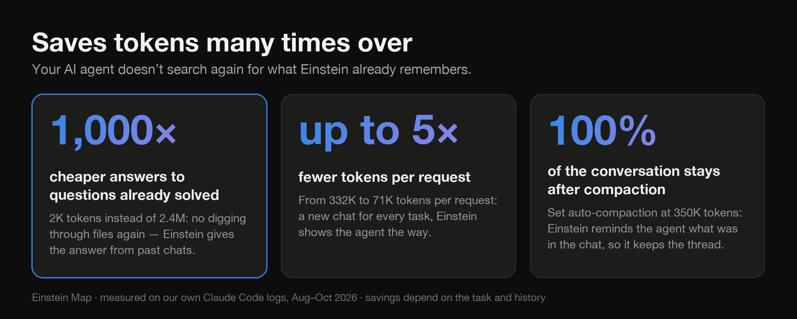

<p align="center">
  
</p>

# Einstein Map — Persistent Memory for Codex and Claude Code

**Continue work across chats, find past decisions, and switch between OpenAI Codex and Anthropic Claude Code with one shared memory.** Less re-explaining, less re-searching and less repeated context means fewer tokens and less money spent.

Einstein Free is completely free: no account, no subscription, no separate API key and nothing extra to pay for tokens or compaction. It works on Mac and Windows, and your conversation history stays on your computer.

**[Download Free for Mac](https://github.com/reekeg-sv/einstein-map/releases/download/v0.19.33/einstein-free-0.19.33-hybrid-macos-arm64.tar.gz)** · **[Download Free for Windows](https://github.com/reekeg-sv/einstein-map/releases/download/v0.19.33/einstein-free-0.19.33-hybrid-windows-x86_64.zip)** · [Get Pro on the website — free](https://einsteinmap.com/pro)

**On this page:** [How it works](#how-it-works) · [Token savings](#fewer-repeats-fewer-tokens) · [Free and Pro](#free-and-pro) · [Install](#install-einstein-free) · [Check that it works](#check-that-memory-works) · [Connect Pro](#connect-pro-and-project-maps) · [Privacy](#data-and-privacy) · [FAQ](#faq) · [Guides](#guides) · [Help](#help-and-feedback)

<p align="center">
  
</p>

## Why Codex and Claude Code need memory

A new chat in Codex or Claude Code starts from a blank page. The agent does not remember that yesterday you found the cause of a bug, chose a library or agreed not to touch a file. You explain everything again, the agent rereads the same files, and that costs time, tokens and, above all, your money.

Einstein is the bridge between past chats and current work. If a question has been discussed before, Einstein remembers it and tells your AI agent where you left off.

## How it works

1. In a new chat, when a question looks like one you have already discussed, Einstein suggests the earlier decision, command or file to Claude Code or Codex.
2. With Pro, Einstein keeps a map of your project: what exists, what is being done and what was decided. You can run complex multi-step projects without worrying that the agent will forget something, start over or re-test an option you rejected long ago.

## Memory across sessions: continue the chat where you left off

- Continue work from the records of previous sessions.
- Find the earlier fix instead of searching for it again.
- Keep the thread after context compaction: Einstein reminds the agent what was in the chat, so it does not lose the thread of the conversation.
- Switch between Codex and Claude Code on the same computer: Einstein combines their local history.
- Keep facts, plans and decisions in Pro project maps.

**Recommended compaction threshold: about 350K tokens** on models with a 1M-token context window. Long chats cost more on every request; with Einstein you can compact earlier and save on the context window without losing what was said.

## Shared memory for Codex and Claude Code

On one computer, both agents use one history. Started a task in Claude Code and hit the limit? Continue in Codex without retelling the story, and the other way round.

## Search your conversation history

Find an old conversation with two or three words:

```sh
einstein find "connection refused"
```

Or simply ask your agent: *“Find how we fixed this last time.”* Search covers the conversations of both agents.

## Fewer repeats, fewer tokens

Without memory the agent investigates the same error again and rereads files, and you explain the task again. That is time, tokens and, in the end, your money. Einstein brings the answer you already found back into the work.

Measured on our own Claude Code logs, August–October 2026:

| | Without Einstein | With Einstein |
|---|---|---|
| A question that was already solved | about 2.4M tokens to research it again | about 2K tokens from memory: **up to 1,000× cheaper** |
| Context per request | 332K tokens on average in long chats | 71K with a new chat for each task: **up to 5× fewer** |
| After context compaction | details are lost and the agent drifts | the whole conversation stays in Einstein |

Actual savings depend on the task and on the history you have accumulated.

You pay nothing extra for the memory itself. Einstein does not summarize or compress your chats with AI; it searches them directly on your computer, and only a short hint goes into the agent's context. Your Codex or Claude Code subscription and limits apply as usual.

## Free and Pro

| | Free | Pro |
|---|---|---|
| Search past chats | Yes | Yes |
| Hints from saved conversations | Yes | Yes |
| Fact Map and Plan Map | — | Yes |
| Project maps in the browser | — | Yes |
| Account required | No | Yes |
| Where to get it | [GitHub Releases](https://github.com/reekeg-sv/einstein-map/releases/tag/v0.19.33) | [einsteinmap.com/pro](https://einsteinmap.com/pro) |

Pro is currently free. Current terms are on the [website](https://einsteinmap.com/pro).

## Install Einstein Free

| System | Package |
|---|---|
| Mac with Apple Silicon, macOS 12 or newer | [Download for macOS arm64](https://github.com/reekeg-sv/einstein-map/releases/download/v0.19.33/einstein-free-0.19.33-hybrid-macos-arm64.tar.gz) |
| Windows 10/11, x86_64 | [Download for Windows x86_64](https://github.com/reekeg-sv/einstein-map/releases/download/v0.19.33/einstein-free-0.19.33-hybrid-windows-x86_64.zip) |

1. Download the package for your system and extract it. Keep the whole `einstein.dist` folder together.
2. Ask your AI agent: **“Read INSTALL-AI.md in this folder and install Einstein.”** Add “only for Codex” or “only for Claude Code” if you want just one.
3. Read the installer's summary: it names the connected agents and the launcher command.
4. In Codex, open `/hooks`, review and approve the Einstein entries yourself. Then start a **new chat**. In Claude Code, also start a new chat after installation.

Manual installation: open Terminal or PowerShell inside `einstein.dist`.

```sh
./einstein-hybrid install          # Mac
.\einstein-hybrid.exe install      # Windows PowerShell
```

To connect only one agent, add `--assistant codex` or `--assistant claude`.

Linux is not supported in this release. Checksums: [SHA256SUMS.txt](https://github.com/reekeg-sv/einstein-map/releases/download/v0.19.33/SHA256SUMS.txt).

## Check that memory works

`einstein` below is the launcher printed by the installer. If the short command is not available, use the full path from the installer's summary.

```sh
einstein --version
einstein verify
einstein find "two familiar words"
```

Pick words from a real earlier conversation. Then open a new chat and ask about a file, command or decision from it. A hint appears when there is a matching record; not every message needs one.

## Connect Pro and project maps

Open [einsteinmap.com/pro](https://einsteinmap.com/pro), sign in and follow the instructions there. Pro downloads are only on the website. If Einstein is already installed:

```sh
einstein connect
einstein pro status
```

If the site asks to replace your previous computer, open the latest confirmation email, follow the link and press **“Replace the computer”** on the page that opens. Opening the link alone is not enough. If the connection stopped, run `einstein connect` again.

The **Fact Map** holds what exists in the project. The **Plan Map** holds work, decisions and their status. Your AI agent writes the records; Einstein stores them and suggests what is relevant. For example: *“Write this decision into the project map.”* See `einstein help maps` for working with projects.

## Data and privacy

Your conversation archive and search stay on your computer. Pro maps are stored encrypted on the Einstein server, and access is restricted to your account.

Automatic technical reports contain the program version, system, command counters and errors. They contain no chat text, questions, project names, file paths or keys. To check or turn them off:

```sh
einstein report auto status
einstein report auto off
```

`einstein report` shows a local troubleshooting report. Read it before sending it with `einstein report --send`.

## FAQ

**Do Codex and Claude Code have their own memory?**
Both have instruction files that you write in advance (`AGENTS.md`, `CLAUDE.md`). Einstein does not replace them; it adds search over what was actually discussed and done in past chats.

**Do I need an API key or another subscription?**
No. Memory search runs on your computer. The subscription and limits of Codex or Claude Code apply as usual.

**Do my conversations go to the internet?**
No. The archive and search stay on your computer. Only Pro maps and technical reports without chat text go to the server.

**Is Einstein open source?**
No. This repository contains product information and ready-to-use Free packages; the source code is not published.

## Guides

- [How to Continue a Claude Code Conversation in a New Session](https://reekeg-sv.github.io/einstein-map/continue-claude-code-conversation/)
- [How to Add Persistent Memory to OpenAI Codex](https://reekeg-sv.github.io/einstein-map/codex-persistent-memory/)
- [Search Your Claude Code and Codex Conversation History](https://reekeg-sv.github.io/einstein-map/search-conversation-history/)
- [How to Reduce Claude Code and Codex Token Usage](https://reekeg-sv.github.io/einstein-map/reduce-token-usage/)
- [Free Shared Memory for Codex and Claude Code](https://reekeg-sv.github.io/einstein-map/shared-memory-codex-claude-code/)

## Help and feedback

[Installation and help](https://einsteinmap.com/help) · [Website](https://einsteinmap.com/) · [Pro](https://einsteinmap.com/pro)

When reporting a problem, include your system, Einstein version, agent, what you did, what you expected and what happened. A screenshot or the error text helps. Do not include passwords, access keys or full private conversations.

This repository distributes product information and the Free packages. Publishing the packages here does not make their source code open source.
